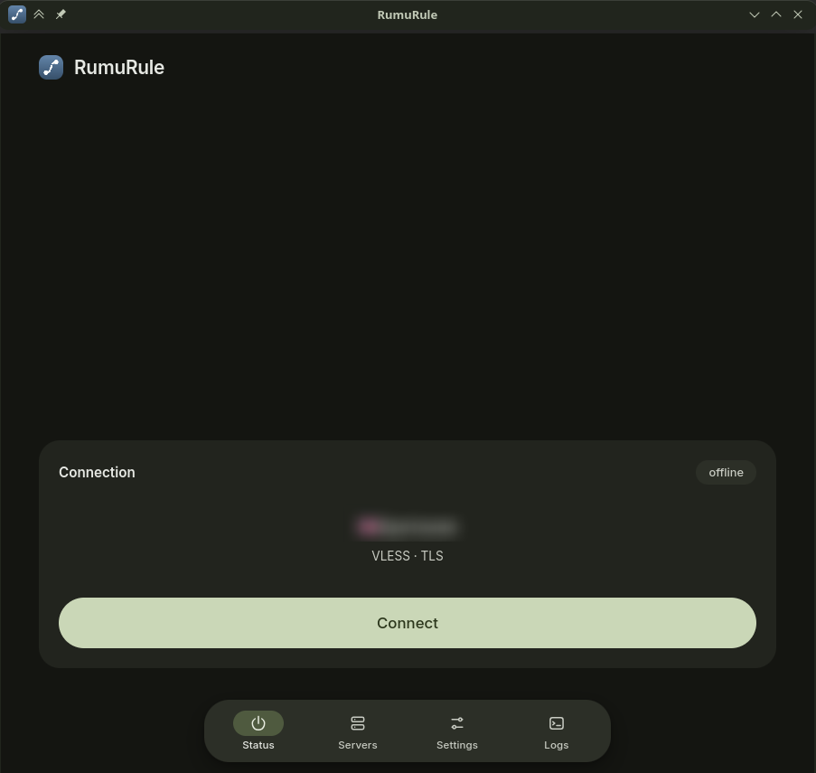
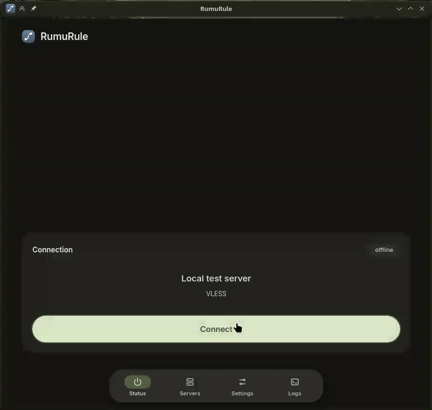
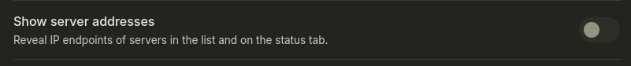

# RumuRule

[Русский](README_ru.md) | **English**

> Desktop client for Linux that runs Xray either as a local SOCKS5/HTTP proxy or as a system-wide TUN interface.

## Requirements

- Rust 1.99+
- WebKitGTK 4.1, GTK 3, libappindicator
- Xray-core 26.11 or newer (the TUN inbound is built in)
- polkit with `pkexec` for TUN mode
- systemd-resolved with `resolvectl` if the tunnel should own system DNS

## Running

```sh
./scripts/fetch-xray.sh                          # pinned core, or: sudo pacman -S xray
cargo run --manifest-path src-tauri/Cargo.toml
```

Packages install the same layout into `/usr/bin`, `/usr/lib/rumurule` and `/usr/share`; see [`packaging/README.md`](packaging/README.md).

## Servers

- Paste a `vless://`, `vmess://`, `trojan://` or `ss://` link, or a subscription URL. Subscriptions may return a link list (plain or base64) or a JSON array of ready-made Xray configs; both are imported.
- A panel's `profile-title` header becomes the group name. Links that are not part of a subscription stay under **Saved servers**.
- Each subscription header collapses its list, shows the server count and has its own latency and refresh buttons. Its `⋯` menu offers test, refresh, rename and remove; a server's menu offers test, rename, pin and remove.
- Each row shows a latency probe. **Settings -> Ping** picks the method: an HTTP GET through the server, a direct TCP handshake, or system ICMP. The proxy probe starts a throwaway Xray instance and supports `default`, `double` and `keep-alive` modes plus a custom test URL. Hysteria is UDP-based, so TCP and proxy probes show `udp`; ICMP still works.
- Subscription requests carry a stable device id (HWID) by default, because some panels bind a subscription to one device. Toggle it in **Settings**; **Reset** generates a new id.
- Saved servers live in `~/.config/slop.rumurule/profiles.json`, settings in `settings.json`.

## Status tab



The first tab is the connection itself: the current server, a live session timer and one Connect/Disconnect button for the server picked in **Servers**. Clicking a row only selects it; a running session moves to the chosen server right away.



A higher quality clip of the same session is in [`examples/session.mp4`](examples/session.mp4).

## System proxy

**System proxy** is on by default. While a server is connected, the app writes the local endpoints to the desktop settings and restores the previous values on disconnect: `[Proxy Settings]` in `~/.config/kioslaverc` for KDE, and `org.gnome.system.proxy` through `gsettings` for GNOME/GTK.

The old configuration is saved in `~/.config/slop.rumurule/proxy/` before the first change, and put back on the next start if the app was killed while connected. Apps pick the change up on the next request; restart a browser that keeps its own proxy settings.

## TUN mode

**Settings -> Tunnel -> TUN** routes every application through the server. Xray creates the `rumurule0` interface, installs the default routes and points system DNS at the tunnel. The local SOCKS5/HTTP endpoints stay available next to it, so the TUN, the system proxy, or both can be used at once.

TUN needs `CAP_NET_ADMIN`, which the GUI does not have. The **rumurule-helper** binary does the privileged part and is started through `pkexec`; polkit shows one prompt for the `slop.rumurule.tunnel` action.

Development install:

```sh
cargo build --release -p rumurule-helper
sudo ./scripts/install-helper.sh
```

How the helper owns the tunnel, resolves outbound domains and handles FakeDNS, MTU and shutdown is described in [`docs/tun.md`](docs/tun.md).

## Privacy

The status tab and the server list hide IP endpoints by default: they show the label, protocol and transport only. **Settings -> Show server addresses** reveals the `server:port` details everywhere.



## Xray lookup order

1. `RUMURULE_XRAY` environment variable
2. `$XDG_DATA_HOME/slop.rumurule/bin/xray`
3. `/usr/lib/rumurule/xray`
4. `xray` from `PATH`

## Debugging

```sh
cargo run -p rumurule-core --example dump_config -- 'vless://...'   # generated config
cargo run -p rumurule-core --example fetch_sub -- https://example.com/sub
```

## Layout

- `crates/core/` — protocol, config and storage logic, no Tauri dependency, unit tested.
- `src-tauri/` — thin Tauri bridge: commands, system proxy, Xray sidecar, TUN session, KDE theme.
- `ui/` — frontend: ES modules in `js/`, styles in `css/`.
- `helper/` — the small root process that owns Xray in TUN mode.
- `packaging/` — PKGBUILD, `.desktop`, polkit action and icons.
- `scripts/` — `fetch-xray.sh`, `install-helper.sh`, `tun-test.sh`.

## License

GNU Affero General Public License v3.0 only. See [LICENSE](LICENSE) and [NOTICE](NOTICE). If you run a modified version as a network service, section 13 requires you to offer its source code to the users of that service.
