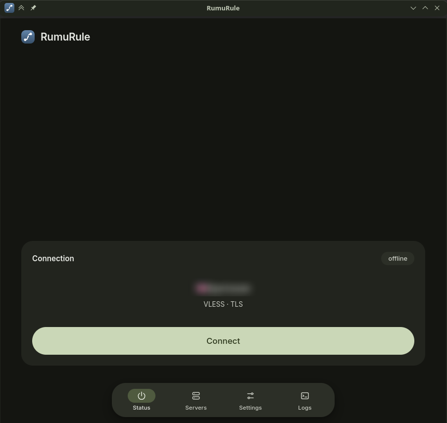
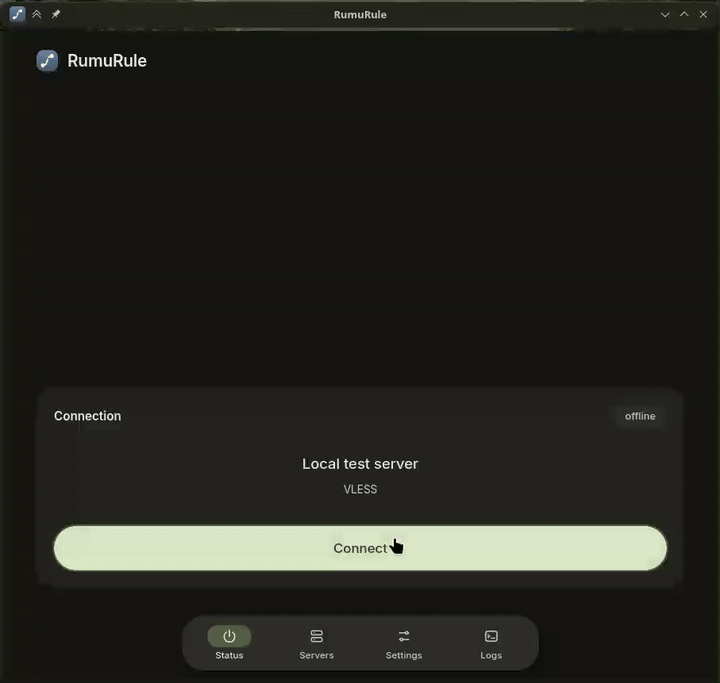
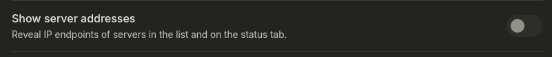

# RumuRule

[English](README.md) | **Русский**

> Десктопный клиент для Linux, который запускает Xray либо как локальный SOCKS5/HTTP-прокси, либо как системный TUN-интерфейс.

## Установка

Скачайте `rumurule-0.9.2-1-x86_64.pkg.tar.zst` из
[pre-release 0.9.2](https://github.com/Sho1don/RumuRule/releases/tag/v0.9.2)
и установите:

```sh
sudo pacman -U rumurule-0.9.2-1-x86_64.pkg.tar.zst
```

В Debian 12+, Ubuntu 23.10+ и производных возьмите из того же релиза
`rumurule_0.9.2-1_amd64.deb` и выполните
```sh
sudo apt install ./rumurule_0.9.2-1_amd64.deb
```

Пакет ставит интерфейс, helper, polkit-действие и закреплённое ядро Xray в `/usr`.

## Требования

- Rust 1.99+
- WebKitGTK 4.1, GTK 3, libappindicator
- Xray-core 26.11 или новее (TUN-inbound встроен в ядро)
- polkit с `pkexec` для режима TUN
- systemd-resolved с `resolvectl`, если DNS должен уходить в туннель

## Запуск

```sh
./scripts/fetch-xray.sh                          # закреплённое ядро, или: sudo pacman -S xray
cargo run --manifest-path src-tauri/Cargo.toml
```

Пакеты ставят ту же раскладку в `/usr/bin`, `/usr/lib/rumurule` и `/usr/share`; см. [`packaging/README.md`](packaging/README.md).

## Серверы

- Вставьте ссылку `vless://`, `vmess://`, `trojan://` или `ss://`, либо URL подписки. Подписка может вернуть список ссылок (обычный или base64) или JSON-массив готовых конфигов Xray — импортируются оба варианта.
- Заголовок `profile-title` из панели становится именем группы. Ссылки, не входящие в подписку, остаются в **Saved servers**.
- Заголовок подписки сворачивает список, показывает число серверов и имеет свои кнопки задержки и обновления. Меню `⋯` подписки предлагает проверку, обновление, переименование и удаление; меню сервера — проверку, переименование, закрепление и удаление.
- В каждой строке видна задержка. **Settings -> Ping** выбирает метод: HTTP GET через сервер, прямое TCP-рукопожатие или системный ICMP. Прокси-проба поднимает одноразовый Xray и поддерживает режимы `default`, `double` и `keep-alive` плюс свой URL для проверки. Hysteria работает по UDP, поэтому TCP- и прокси-пробы показывают `udp`; ICMP при этом работает.
- Запросы подписки по умолчанию несут стабильный идентификатор устройства (HWID), потому что некоторые панели привязывают подписку к одному устройству. Переключается в **Settings**; **Reset** генерирует новый.
- Сохранённые серверы лежат в `~/.config/slop.rumurule/profiles.json`, настройки — в `settings.json`.

## Вкладка Status



Первая вкладка — это само подключение: текущий сервер, живой таймер сессии и одна кнопка Connect/Disconnect для сервера, выбранного в **Servers**. Нажатие на строку только выбирает сервер; идущая сессия сразу переезжает на выбранный.



Ролик того же действия в лучшем качестве — [`examples/session.mp4`](examples/session.mp4).

## Системный прокси

**System proxy** включён по умолчанию. Пока сервер подключён, приложение прописывает локальные эндпоинты в настройки рабочего стола и возвращает прежние значения при отключении: `[Proxy Settings]` в `~/.config/kioslaverc` для KDE и `org.gnome.system.proxy` через `gsettings` для GNOME/GTK.

Прежняя конфигурация сохраняется в `~/.config/slop.rumurule/proxy/` перед первым изменением и возвращается при следующем запуске, если приложение убили во время сессии. Приложения подхватывают изменение со следующего запроса; браузер, который держит собственные настройки прокси, нужно перезапустить.

## Режим TUN

**Settings -> Tunnel -> TUN** направляет весь трафик приложений через сервер. Xray создаёт интерфейс `rumurule0`, ставит маршруты по умолчанию и переключает системный DNS на туннель. Локальные SOCKS5/HTTP-эндпоинты остаются доступны рядом, так что можно пользоваться TUN, системным прокси или тем и другим сразу.

Для TUN нужен `CAP_NET_ADMIN`, которого у интерфейса нет. Привилегированную часть делает бинарник **rumurule-helper**, он запускается через `pkexec`; polkit показывает один запрос для действия `slop.rumurule.tunnel`.

Установка для разработки:

```sh
cargo build --release -p rumurule-helper
sudo ./scripts/install-helper.sh
```

Как helper владеет туннелем, резолвит домены исходящих, обходится с FakeDNS, MTU и остановкой — в [`docs/tun.md`](docs/tun.md).

## Приватность

Вкладка Status и список серверов по умолчанию скрывают IP-эндпоинты: видно только название, протокол и транспорт. **Settings -> Show server addresses** показывает `server:port` везде.



## Порядок поиска Xray

1. переменная окружения `RUMURULE_XRAY`
2. `$XDG_DATA_HOME/slop.rumurule/bin/xray`
3. `/usr/lib/rumurule/xray`
4. `xray` из `PATH`

## Отладка

```sh
cargo run -p rumurule-core --example dump_config -- 'vless://...'   # сгенерированный конфиг
cargo run -p rumurule-core --example fetch_sub -- https://example.com/sub
```

## Структура

- `crates/core/` — протоколы, конфиг и хранение; без зависимости от Tauri, покрыт тестами.
- `src-tauri/` — тонкий мост Tauri: команды, системный прокси, sidecar Xray, TUN-сессия, тема KDE.
- `ui/` — фронтенд: ES-модули в `js/`, стили в `css/`.
- `helper/` — небольшой процесс root, который владеет Xray в режиме TUN.
- `packaging/` — PKGBUILD, `.desktop`, действие polkit и иконки.
- `scripts/` — `fetch-xray.sh`, `install-helper.sh`, `tun-test.sh`.

## Лицензия

GNU Affero General Public License v3.0 only. См. [LICENSE](LICENSE) и [NOTICE](NOTICE). Если вы запускаете изменённую версию как сетевой сервис, раздел 13 требует предоставить его пользователям исходный код.
